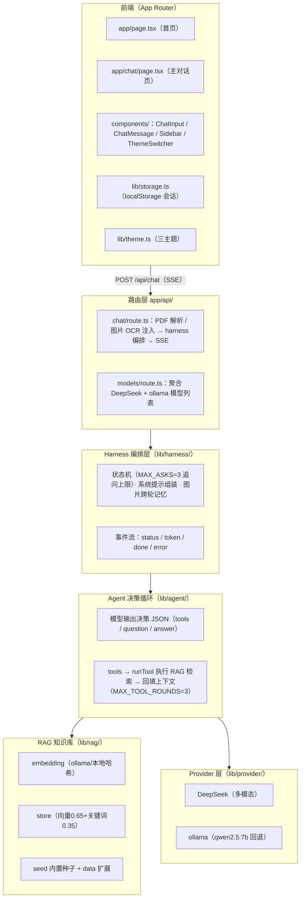
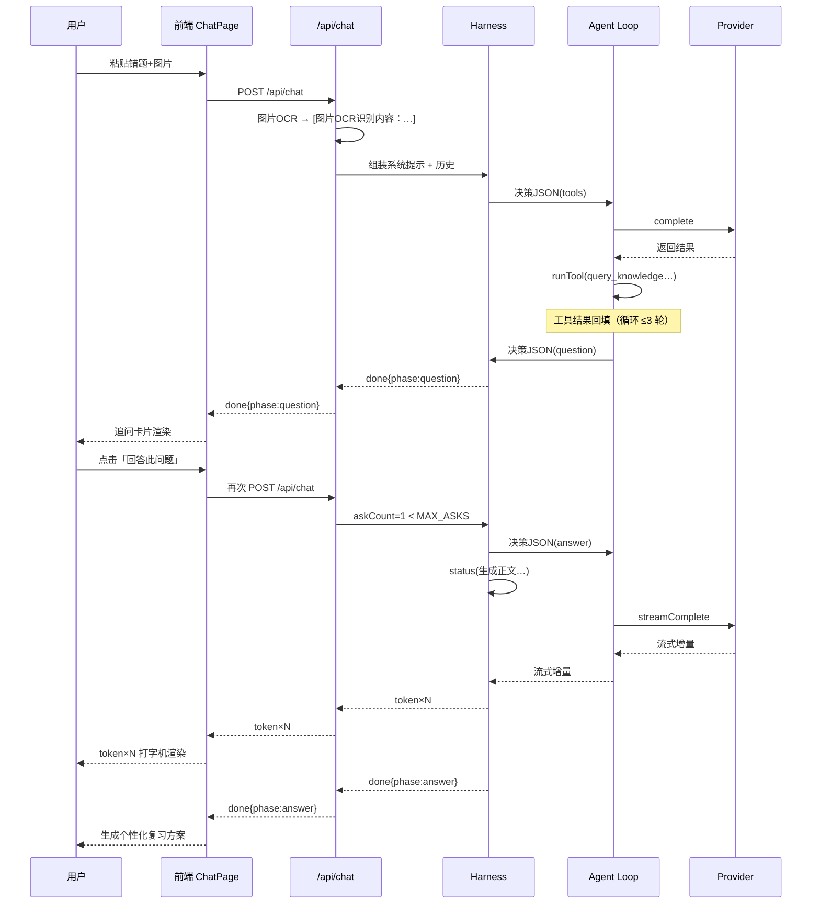

---
AIGC:
    Label: "1"
    ContentProducer: 001191440300708461136T1XGW3
    ProduceID: 26846db51993bfa99bd7045d69d41c5a_a580dd56d20011f1992e525400638852
    ReservedCode1: jASuC6YIijfF8Whr1RR2Mrm/Jfk5hMd16m6OhKhh21AqrSB1zZnX28N9eeGgMVjkzhcdFpVAAIWqQnY/kUhBGaxjkfrnfQfDvMbnU1DOyuaILxmLnjlyPJ2yDQK0uEpnrcQOsB5q1GPhRNHoQ4tnojHOAUep0sI+ayApQs0DFYd+hqOI/BvV1HykV+U=
    ContentPropagator: 001191440300708461136T1XGW3
    PropagateID: 26846db51993bfa99bd7045d69d41c5a_a580dd56d20011f1992e525400638852
    ReservedCode2: jASuC6YIijfF8Whr1RR2Mrm/Jfk5hMd16m6OhKhh21AqrSB1zZnX28N9eeGgMVjkzhcdFpVAAIWqQnY/kUhBGaxjkfrnfQfDvMbnU1DOyuaILxmLnjlyPJ2yDQK0uEpnrcQOsB5q1GPhRNHoQ4tnojHOAUep0sI+ayApQs0DFYd+hqOI/BvV1HykV+U=
---

# notesync 技术文档

**错题认知诊断引擎 — AI Web 应用参赛作品**

| 项目 | 内容 |
| --- | --- |
| 项目名称 | notesync |
| 文档版本 | 1.0 |
| 适用分支 | dev（已合并 devtest 的全部 AI 深化功能） |
| 技术栈 | Next.js 16.4.3 / React 19.3.0 / TypeScript 5 / Tailwind CSS 4 / Turbopack |
| 关联文档 | README.md（快速上手）、.env.example（环境变量模板） |

---

## 1. 项目定位与设计目标

notesync 是一个面向学生的**错题认知诊断引擎**：学生上传错题（文字 / 图片 / PDF），系统不是简单搜题给答案，而是通过**多轮追问 + 知识库增强检索**定位学生的知识薄弱点，最终生成个性化诊断报告与复习方案。

核心设计目标：

1. **诊断而非搜题**：以「定位薄弱点 → 生成复习方案」为闭环，区别于传统拍照搜题。
2. **本地优先**：OCR、RAG 检索、本地模型推理均可离线完成，数据不出电脑，兼顾隐私与成本。
3. **云端增强**：配置 DeepSeek API Key 后可获得更强的多模态推理能力（真实图片理解），与本地模式无缝切换。
4. **可控的 AI 交互**：通过 Agent 决策协议约束模型输出，通过追问状态机防止死循环，保证诊断过程可解释、可追踪。

---

## 2. 系统总体架构



分层职责：

| 层 | 模块 | 职责 |
| --- | --- | --- |
| 前端 | app/ + components/ | 会话式聊天 UI、SSE 流式渲染、追问卡片、思考面板、主题 |
| 路由层 | app/api/chat、app/api/models | 请求收口：附件解析注入、SSE 协议封装、模型列表聚合 |
| 编排层 | lib/harness/ | 诊断状态机、系统提示组装、图片跨轮记忆、事件流产出 |
| Agent 层 | lib/agent/ | 决策 JSON 解析、工具调用循环、思考记录 |
| 知识库 | lib/rag/ | 嵌入、混合检索、种子数据、结果格式化回填 |
| 推理层 | lib/provider/ | 双 Provider 统一接口与路由、流式/非流式生成 |
| 工具层 | lib/ocr.ts、lib/pdf.ts | tesseract.js OCR、pdfjs-dist PDF 文本提取 |

---

## 3. 核心模块详解

### 3.1 Agent 决策循环（lib/agent/）

**文件**：`lib/agent/loop.ts`、`tools.ts`、`types.ts`

Agent 层采用**结构化决策协议**：每轮向模型发送带决策协议的提示，模型必须输出 JSON 决策，字段结构如下：

```json
{
  "action": "tools | question | answer",
  "questions": ["追问问题1", "追问问题2"],
  "image_summary": "图片内容一句话摘要（可选）",
  "plan": "诊断计划（可选）",
  "tool_calls": [
    { "name": "query_knowledge", "arguments": { "query": "一元二次方程" } }
  ]
}
```

**决策循环流程**（`runAgentLoop`）：

1. 向模型请求决策 JSON（`json: true` 提示）。
2. `parseDecision` 解析并归一化：
   - `extractJsonObject` 容忍 ` ```json ` 代码块围栏与前后杂讯，回退到提取第一个平衡的 `{...}` 块；
   - 校验 `action` 必须为 `tools` / `question` / `answer` 三者之一；
   - `questions` 最多取 5 个、过滤空串；`image_summary` 截断 400 字符；`tool_calls` 每轮最多取 3 个。
3. 若 `action === "tools"` 且有工具调用：
   - 逐个执行 `runTool(name, arguments)`；
   - 工具结果以 `[工具结果] ...` 消息回填上下文（单条截断 `TOOL_RESULT_LIMIT=2000` 字符）；
   - 记录思考步骤（工具名、参数、命中条数、来源列表）；
   - 回到第 1 步继续（**上限 `MAX_TOOL_ROUNDS=3` 轮**）。
4. 若 `action === "question"` / `answer`：结束循环，由 harness 决定输出追问或生成正文。
5. 模型输出无法解析为合法决策时：记录「模型输出格式异常，已切换为直接诊断模式」，**强制走 answer**，保证健壮性。

**内置工具**（`tools.ts`）：

| 工具 | 用途 |
| --- | --- |
| `query_knowledge` | 查询 RAG 知识库中与题目相关的知识点 |
| `find_similar_problems` | 检索相似错题案例 |
| `generate_review_plan` | 生成复习计划建议 |

工具统一返回 `{ ok, text, sources }` 结构，`text` 为回填内容，`sources` 为引用来源列表（前端展示「参考：…」）。

### 3.2 Harness 编排与状态机（lib/harness/）

**文件**：`lib/harness/index.ts`、`state.ts`、`prompts.ts`、`types.ts`

Harness 是 Agent 工作流的编排中枢，核心职责：

1. **系统提示组装**（`buildSystemPrompt`）：
   - 注入状态块 `buildStateBlock`（当前诊断进度、已追问轮数、工具描述）；
   - 根据是否有图片附件（`hasImage`）与已追问次数（`askCount`）动态调整提示策略。
2. **追问状态机**：
   - `deriveAskCount` 从历史消息中统计已发生的追问轮数；
   - 当模型决策为 `question` 且追问数 `< MAX_ASKS(=3)` 时，输出 `phase: "question"` 追问事件；
   - **追问数达到上限时，即使模型还想追问，也强制进入诊断（answer）**，杜绝死循环。
3. **图片跨轮记忆**：
   - 首轮模型生成 `image_summary`（图片内容一句话摘要）；
   - 后续轮次不再重传原图，而是引用 `[该图片内容摘要（上一轮模型识别）：…]`，既保留语义又避免请求体过大；
   - 单张图片 dataUrl 上限 `MAX_IMAGE_DATA_URL = 12MB`（base64 长度），超限图片不随请求上传，仅保留文本标注。
4. **流式正文生成**：
   - 进入 answer 分支后先发 `status("正在生成诊断正文…")`；
   - 若 Provider 支持 `streamComplete` 则逐段流式下发 `token` 事件，否则一次性 `complete` 后整体发送；
   - 完成时发送 `done` 事件，携带完整结果。

**SSE 事件协议**（路由层序列化）：

| 事件 | data 字段 | 语义 |
| --- | --- | --- |
| `status` | `{ message }` | 阶段状态提示（如「正在理解题目信息…」「正在生成诊断正文…」） |
| `token` | `{ text }` | 诊断正文增量（打字机渲染） |
| `done` | `{ phase, questions, content, model, provider, imageSummary?, thinking? }` | 一轮诊断结束；`phase=question` 时 `questions` 非空、`content` 为空；`phase=answer` 时反之 |
| `error` | `{ error }` | 友好错误信息 |

`thinking` 数组完整记录 Agent 思考过程：状态消息、工具调用（工具名 / 参数 / 结果摘要 / 来源），供前端「诊断过程」面板展示。

### 3.3 RAG 知识库（lib/rag/）

**文件**：`lib/rag/embedding.ts`、`seed.ts`、`store.ts`、`types.ts`

知识库是诊断依据的来源，采用**向量 + 关键词混合检索**：

- **嵌入生成**：优先调用本地 ollama `/api/embed` 生成向量；ollama 不可用时回退到**本地哈希嵌入**兜底，保证无外部服务也能检索（牺牲一定语义质量换取可用性）。
- **混合检索**：向量相似度 0.65 + 关键词命中 0.35 加权融合排序，兼顾语义相关与术语命中。
- **种子数据**（`seed.ts`）：内置数学知识点与错题案例，保证开箱即有可检索内容。
- **扩展机制**：支持通过 `data/knowledge.json` 扩展知识库（当前仓库未提供 `data/` 目录，为可选能力）。
- **结果回填**：`formatHits` 将命中的知识点/案例格式化为工具结果文本，回填进 Agent 上下文，并携带 `sources` 供前端展示引用来源。

### 3.4 双 Provider 路由（lib/provider/）

**文件**：`lib/provider/index.ts`、`deepseek.ts`、`ollama.ts`、`types.ts`

统一 `LLMProvider` 接口（`complete` / `streamComplete` / `listModels`），路由逻辑（`resolveProvider`）：

```
请求模型名 ∈ DEEPSEEK_MODELS（deepseek-flash / deepseek-v4-pro）
  ├─ 配置了 DEEPSEEK_API_KEY → DeepSeek 官方 API（多模态，支持真实图片上传）
  └─ 未配置 Key            → 回退 ollama 默认模型 qwen2.5:7b
其余模型名（qwen2.5:7b、ollama 自定义模型） → ollama 本地服务（默认 11434 端口）
```

- **DeepSeek 分支**：`deepseekAvailable()` 检测 `DEEPSEEK_API_KEY`；支持多模态 `content` 数组（文本 + `image_url`），历史图片仅保留摘要（见 3.2 跨轮记忆）。
- **ollama 分支**：仅文本；模型列表通过 `GET /api/tags` 拉取，失败时 `available=false` 并返回友好提示。
- **模型列表聚合**（`getModelList`）：有 Key 时 DeepSeek 模型在前、ollama 模型追加在后；无 Key 时仅 ollama 模型；ollama 未运行返回空列表与提示文案。

### 3.5 OCR 兜底（lib/ocr.ts）

- 基于 **tesseract.js 7**，服务端**单例 worker**（复用避免重复初始化开销）。
- **离线语言包**：使用 `tessdata/` 目录下的 `chi_sim.traineddata.gz`（简体中文），语言包随仓库分发，**无需在线下载**；`eng` 语言包亦随仓库分发。
- 图片附件在路由层自动 OCR，识别文本以 `[图片OCR识别内容：...]` 注入用户消息上下文；识别失败时标注 `[图片OCR识别：未识别到文字或识别失败]`。
- 大图 / 超时等异常场景降级为文本标注，不影响对话主流程。
- `next.config.ts` 中将 `tesseract.js` 列入 `serverExternalPackages`，避免 Turbopack 打包其 worker 文件。

### 3.6 PDF 解析（lib/pdf.ts）

- 基于 **pdfjs-dist 5** 服务端提取 PDF 文本。
- 在 `/api/chat` 路由层完成：PDF 附件解析后以 `[PDF内容：...]` 注入用户消息上下文；解析失败标注 `[PDF内容：解析失败或为空]`。
- 注入逻辑具备**幂等保护**：已注入过（内容包含 `[PDF内容：` 或 `[图片OCR识别内容：`）的历史消息不会被重复解析。

### 3.7 前端交互设计（app/ + components/）

| 页面 / 组件 | 职责与交互 |
| --- | --- |
| `app/page.tsx` | 首页引导页：产品口号、「开始对话诊断」（→ /chat）、「传统上传诊断」（→ /diagnose）双入口 |
| `app/chat/page.tsx` | 主对话诊断页：会话分支管理、SSE 流式渲染、追问卡片、思考面板、模型切换、停止生成、ollama 连接状态提示、空态引导 |
| `app/diagnose/page.tsx` | 传统上传诊断页（简化版）：文件选择 / 预览 / 诊断入口，用于展示上传诊断形态 |
| `components/ChatInput.tsx` | 输入区：文字粘贴、图片/PDF 附件上传（支持粘贴图片）、附件预览与移除、模型下拉选择、发送/停止按钮、「回答追问」提示条 |
| `components/ChatMessage.tsx` | 消息气泡：用户（右）/ AI（左）、附件预览、追问卡片（点击「回答此问题」回填输入框）、思考面板（默认折叠）、模型署名 |
| `components/Sidebar.tsx` | 会话列表：新建 / 切换 / 删除、侧栏折叠、底部主题切换 |
| `components/ThemeSwitcher.tsx` | 三主题切换器（暗色 / 浅绿 / 浅蓝） |

**核心交互链路**：

1. 用户在输入区粘贴文字 / 上传图片 / PDF，点击发送。
2. 前端先插入一条空的 AI 消息，`fetch("/api/chat")` 建立 SSE 流，逐段渲染 `token` 事件（打字机效果）。
3. `done` 事件若为 `phase=question`，渲染**追问卡片**：列出问题并提供「回答此问题」按钮，点击后自动回填输入框。
4. 用户回答后再次发送，harness 统计追问轮数，直到达到 `MAX_ASKS` 或模型判定信息充足，进入 `phase=answer` 生成最终诊断。
5. 每轮 AI 消息携带 `thinking` 数组，可在「诊断过程」面板中展开查看工具调用与知识库检索记录（含参考来源）。
6. 完整回复统一落盘到 localStorage，流式渲染期间的中间态不落盘，避免脏数据。

**主题系统**：`globals.css` 定义三套 CSS 变量主题（`dark` / `green` / `blue`），`layout.tsx` 内联防闪烁脚本在 HTML 解析阶段即读取 localStorage 设置 `data-theme`；所有组件颜色引用 CSS 变量，主题切换全局即时同步并持久化。

**会话持久化**（`lib/storage.ts`）：localStorage 键 `mistake-diagnosis-conversations`；支持多会话（对话分支）新建 / 切换 / 删除；`cleanMessages` 清理历史脏消息（同 id 去重、丢弃无内容空 AI 消息）；`makeTitle` 取首条消息前 20 字作为标题。

### 3.8 API 路由设计

**POST /api/chat**（SSE 文本流）

- 请求：`{ conversationId, model, messages: Message[] }`（兼容 `content` / `attachments` 直传形式）。
- 处理：
  1. 对历史最后一条用户消息执行 PDF 解析 / 图片 OCR，注入 `[PDF内容：…]` / `[图片OCR识别内容：…]`（幂等保护）；
  2. 调用 `runHarnessStream` 编排 Agent 工作流；
  3. 将 `status / token / done / error` 事件序列化为 `text/event-stream`。
- 响应头：`Content-Type: text/event-stream`、`Cache-Control: no-cache, no-transform`、`X-Accel-Buffering: no`；单次请求最长 120 秒超时。

**GET /api/models**

- 返回：`{ models: ProviderModel[], available: boolean, message?: string }`。
- 有 `DEEPSEEK_API_KEY`：DeepSeek 模型（deepseek-flash / deepseek-v4-pro）+ ollama 模型（若可用）；
- 无 Key：仅 ollama 模型；ollama 未运行返回 `available=false` 与安装提示。

---

## 4. 一次完整诊断流程（时序示例）



---

## 5. 构建与部署

### 5.1 环境准备

- Node.js 20+
- 任一推理后端：DeepSeek API Key 或本地 ollama（默认 `qwen2.5:7b`，端口 11434）

### 5.2 构建命令

```bash
npm install          # 安装依赖
npm run dev          # 开发模式（Turbopack）
npm run build        # 生产构建
npm run start        # 生产启动（next start）
npm run lint         # ESLint 检查
```

### 5.3 部署要点

- 部署环境需注入 `DEEPSEEK_API_KEY`（如未配置，则需保证 ollama 服务可达）。
- `tessdata/` 目录须随代码分发或部署时一并上传（OCR 离线语言包）。
- API 密钥严禁写入仓库，统一走环境变量（`.env.local` / 部署平台 Secrets）。
- `next.config.ts` 已配置 `serverExternalPackages: ["tesseract.js"]`，无需额外改动。

---

## 6. 环境变量与额外运行时依赖

### 6.1 环境变量

| 变量 | 必填 | 说明 |
| --- | --- | --- |
| `DEEPSEEK_API_KEY` | 否 | DeepSeek 官方 API Key；配置后启用云端多模态模型（deepseek-flash / deepseek-v4-pro） |
| `DEEPSEEK_BASE_URL` | 否 | 自定义 DeepSeek API 地址（默认官方地址） |

模板见 `.env.example`。

### 6.2 额外运行时依赖（package.json 之外）

| 依赖 | 用途 | 获取方式 |
| --- | --- | --- |
| `tessdata/` 语言包（chi_sim / eng traineddata.gz） | tesseract.js 中文 OCR | 随仓库分发，无需在线下载 |
| ollama 模型（默认 `qwen2.5:7b`） | 本地推理后端 | `ollama pull qwen2.5:7b` |
| DeepSeek API Key | 云端多模态推理 | 平台申请后经环境变量注入 |

---

## 7. 评审要点对照

对照 AI Web 大赛评审标准，说明本项目在各维度的设计与实现：

| 评审维度 | 权重 | 本项目对应实现 |
| --- | --- | --- |
| AI 技术深度 | 35% | Agent 决策循环（结构化决策协议 + 工具调用 + 结果回填）、RAG 混合检索（向量 0.65 + 关键词 0.35）、双 Provider 路由与自动回退、追问状态机（MAX_ASKS=3 防死循环）、图片跨轮记忆（imageSummary 压缩上下文）、OCR 与 PDF 多模态输入兜底 |
| 创新性 | 25% | 「诊断而非搜题」的产品形态；多轮追问收敛薄弱点 + 个性化复习方案；本地优先（离线 OCR / RAG / 本地模型）与云端增强（DeepSeek 多模态）的双模架构；思考过程可视化赋予 AI 可解释性 |
| 前端工程质量 | 10% | Next.js 16 App Router + Turbopack、TypeScript 全量类型、Tailwind 4 主题变量化、SSE 流式渲染、组件化（ChatInput / ChatMessage / Sidebar / ThemeSwitcher）、会话持久化与脏数据清理 |
| 实用性 | 10% | 覆盖文字 / 图片 / PDF 三类真实错题场景；本地运行零成本；离线可用；RAG 知识库可扩展（data/knowledge.json） |
| 用户体验 | 10% | 打字机流式输出、追问卡片一键回答、思考过程面板、停止生成、三套主题、多会话分支、ollama 连接状态友好提示 |
| 社会价值与商业潜力 | 10% | 面向学生群体的个性化学习辅导，可复用至错题本 / 学习平台，具备教育工具商业化前景；本地模式保护学生数据隐私 |

**提交材料对照**：

| 比赛要求 | 状态 / 说明 |
| --- | --- |
| 代码仓库（Public） | 项目仓库（GitHub/Gitee 公开） |
| README | 已提供（项目根目录 README.md） |
| 演示视频（5-8 分钟，1080p） | 待录制（建议覆盖文字 / 图片 / PDF 三种输入与追问闭环） |
| 技术文档 | 本文档；PDF 版后续由本文转换得出 |
| 环境变量模板 | 已提供 `.env.example` |
| Git 提交记录 | 使用规范提交（详见 AGENTS.md：单文件独立提交规范） |

---

## 8. 已知边界与后续规划

**当前已知边界**：

- `app/diagnose/page.tsx` 为简化版上传诊断页，仅提供入口与文件预览，完整诊断逻辑以 `/chat` 对话页为准。
- `data/knowledge.json` 扩展知识库为可选能力，当前仓库未包含 `data/` 目录，使用内置种子数据。
- ollama 分支仅支持文本输入；真实图片多模态理解仅 DeepSeek 分支可用（无 Key 时图片走 OCR 文本兜底）。
- 会话数据保存在浏览器 localStorage，未做云端同步。

**后续规划（方向性建议）**：

- 接入更多学科种子数据与结构化知识图谱，提升 RAG 检索质量；
- 支持导出诊断报告（PDF/图片）与复习计划打卡追踪；
- 增加用户错题本账号体系与云端同步；
- 多模态能力向本地模型迁移（如支持视觉的 ollama 模型），减少对云端 Key 的依赖。
*（内容由AI生成，仅供参考）*
